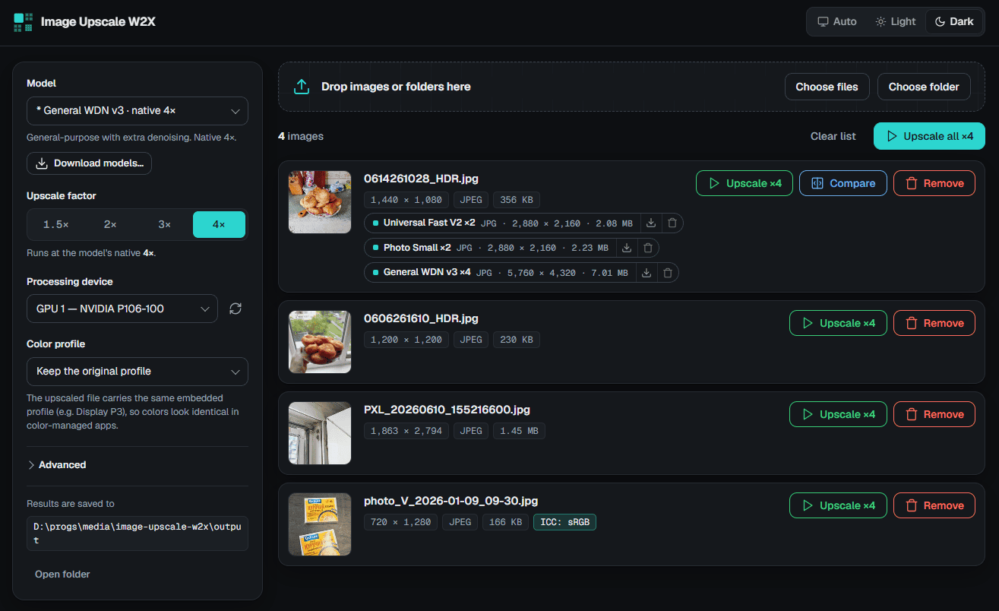

<div align="center">

# Image Upscale W2X

**A fast, private, offline-capable web UI for batch image upscaling with Real-ESRGAN (ncnn-vulkan) and the W2xEX models.**

Drop in a folder, pick a model and a factor, and compare the result against the original with a slider.
Runs on **Windows** and **Linux**, uses your GPU through Vulkan, and never sends a single image over the internet.



</div>

---

## Features

- **Four upscale factors** – ×1.5, **×2 (default)**, ×3 and ×4, whatever the native scale of the model (see [how factors work](#how-factors-work)).
- **Model manager** – download only the models you want, right from the UI. Recommended models sit at the top with a **Recommended** badge, and models you already have are highlighted in green.
- **Device picker** that lists every Vulkan device by name (`GPU 0 — NVIDIA GeForce RTX …`, `GPU 1 — AMD …`).
- **Drag & drop** images or whole folders (sub-folders included), or use the *Choose files* / *Choose folder* buttons.
- **Clear file list** – each image gets a row with a thumbnail, a shortened file name, resolution, format, file size and embedded color profile.
- **Process one or all** – upscale a single image, or everything in the list one by one. Queue with a progress bar, cancel any time.
- **Manage your results** – every result shows its format, resolution and file size; download it, compare it, or delete variants you do not need.
- **[Compare mode](#compare-mode)** – slider or side-by-side, synchronised zoom and pan, the original at stretched *or* native resolution, and any two results against each other.
- **[Color profile handling](#color-profiles)** – keep the original profile (e.g. Display P3) or convert to sRGB, so results do not look washed out.
- **Auto / Light / Dark** theme switch.
- **Output formats** – PNG (lossless), JPEG or WebP.
- **Everything stays in one folder** – engine, models, fonts, results. After the first setup it works **without internet**.
- **Private by default** – the server listens on `localhost` only. [Network mode](#network-mode) is one flag away.
- **Resilient on integrated GPUs** – if the engine crashes, the job is retried automatically with safe settings; a *Compatibility mode* switch is available too. Errors name the real cause and show the engine output.
- **Timing in the console** – every finished job prints how long it took.
- **No build step, no framework, no CDN.** Plain Node.js server + vanilla JS front-end.

## Quick start

### Requirements

| | |
|---|---|
| **Node.js** | 18 or newer – <https://nodejs.org/> |
| **Graphics driver with Vulkan** | Windows: any recent NVIDIA / AMD / Intel driver. Linux: your vendor's driver, or `mesa-vulkan-drivers` |
| **Internet** | only to fetch the engine on the first start (~3 MB) and for each model you choose to download |

### Windows

1. Download the latest release (or clone this repository) and unpack it anywhere.
2. Double-click **`start.bat`**. The server opens in its own console window; press **Ctrl+C** there to stop it.

### Linux (and macOS, best effort)

```bash
git clone https://github.com/tx2x/Image-Upscale-W2X/Image-Upscale-W2X.git
cd Image-Upscale-W2X
./start.sh
```

On the first run the launcher installs the dependencies and downloads the engine, then opens
<http://localhost:7842> in your browser. **No models are downloaded automatically** – the app asks you to pick some (see below).

> **Linux packages** – on Debian/Ubuntu: `sudo apt install libvulkan1 mesa-vulkan-drivers vulkan-tools`
> (NVIDIA users need the proprietary driver instead of Mesa). Run `vulkaninfo --summary` to check that your GPU is visible.

### Manual setup

```bash
npm install            # sharp + adm-zip
npm run setup          # downloads the engine into bin/ (once)
npm start              # starts the server
```

`npm run setup -- --force` re-downloads the engine.

## Getting models

Image Upscale W2X **does not contain any models** and does not bundle anyone else's weights. Models are downloaded only when you ask for it:

1. Click **Download models…** under the model list (it opens automatically on the very first start).
2. Press **Download** next to the models you want. The list is flat; recommended models come first, models you already have are highlighted in green.
3. They are saved into the `models/` folder and appear in the model list immediately.

The four **Recommended** models (`Universal-FastV2-W2xEX`, `Photo-Small-W2xEX`, `Anime-HQ-W4xEX`, `realesr-general-wdn-x4v3`) are listed first; they also carry a `*` in the model drop-down. You can also put any other ncnn model (`name.param` + `name.bin`) into `models/` yourself – a `2x` / `4x` in the file name sets its native scale (4× is assumed otherwise).

## Using the tool

1. **Add images** – drag files or folders onto the window, or use the buttons.
2. **Choose** a model, a factor, a device and a color-profile mode in the left panel.
3. Click **Upscale ×2** on a single image, or **Upscale all** to process the whole list.
4. Click a result chip (or **Compare**) to open [compare mode](#compare-mode). Results are written to the `output/` folder, named `<name>_<model>_x<factor>.<ext>`.

### Managing results

Every upscaled version of an image appears as a chip under its row, for example `Photo Small ×2  PNG · 3840 × 2160 · 8.1 MB`: model, factor, **format**, resolution and **file size** of the new file.

- Click the chip to open it in [compare mode](#compare-mode).
- The **download** icon saves the file; the **trash** icon deletes that variant from the `output/` folder after a confirmation. This cannot be undone.
- *Remove* on the file row only takes the image out of the list; the files in `output/` stay.

Existing files in `output/` are never overwritten – a counter is appended instead (`_2`, `_3`, …). Each finished job prints a line like this in the console:

```
Done:     photo.jpg | Photo Small x2 | 1920x1080 -> 3840x2160 | 4.37 s | GPU 0 (NVIDIA GeForce RTX 3060)
```

## Compare mode


<sub>↑ Put a screenshot of the compare view at <code>docs/compare.png</code>.</sub>

Open it from the **Compare** button of a file, or by clicking one of its result chips.

- **Slider** – drag the handle to wipe between A and B.
- **Side by side** – two panes with synchronised zoom and pan.
- **Any two versions** – A and B can each be the original or any result of that image, so you can compare *different models*, different factors or the *keep-profile* and *sRGB* variants with each other. **Swap** flips A and B.
- **Original stretched or native** – by default the original is enlarged to the result's resolution so both line up perfectly. Tick **Original at native size** to see it at its own resolution instead (centered, 1 original pixel = 1 screen pixel at 100%).
- **Zoom and pan** – mouse wheel zooms around the cursor, drag pans, double-click toggles *fit* / *actual size*. Buttons: `−` `+` `Fit` `100%`.
- **Info bar** – resolution and file size of both images, and whether one is stretched.

Keyboard: `+` `-` zoom · `0` fit · `1` actual size · `Esc` close · arrow keys on the slider handle move the divider.

## Color profiles

Images can carry an embedded color profile (for example *Display P3* from a phone or a Mac). The upscaling engine only sees raw pixel values and drops the profile, which is why a wide-gamut image looks pale after upscaling if nothing is done about it.

If an image has a profile, its row shows a badge such as `ICC: Display P3`. Choose what happens in **Color profile** in the left panel:

| Setting | What it does |
|---|---|
| **Keep the original profile** *(default)* | Pixels are upscaled as they are and the original profile is embedded in the result (PNG, JPEG and WebP). Colors look identical to the source in color-managed apps. |
| **Convert to sRGB** | Colors are converted to sRGB **before** upscaling and no profile is embedded. Choose this if you use viewers or websites that ignore profiles. Results get an `_srgb` suffix and an *sRGB* tag. |

Images without a profile are not affected. CMYK and grayscale profiles are always converted to sRGB. EXIF rotation is applied.

## Network mode

By default the server binds to `127.0.0.1` and rejects requests for any other host name, so no other device (and no website in your browser) can reach it.

To open the UI from another computer or phone on your network:

```bash
start.bat --network          # Windows
./start.sh --network         # Linux / macOS
npm run start:network        # any OS
```

The console prints the address to open, e.g. `http://192.168.1.20:7842`. Other options:

| Option | Meaning |
|---|---|
| `--network` | listen on all interfaces (`0.0.0.0`) – same as setting `W2X_NETWORK=1` |
| `--host <address>` | listen on one specific address |
| `--port <n>` | change the port (default `7842`, or the `PORT` variable) |
| `--no-open` | do not open the browser automatically |

> ⚠️ **There is no password.** Anyone who can reach the port can upload images, use your GPU and download results. Use network mode only on networks you trust. The *Open folder* button is disabled in network mode and models can only be downloaded from the computer that runs the server.

## Offline use

```
Image-Upscale-W2X/
├─ bin/        Real-ESRGAN-ncnn-vulkan executable (downloaded by setup)
├─ models/     the models you downloaded
├─ output/     your upscaled images
├─ public/     the web UI (fonts included – nothing is loaded from a CDN)
├─ scripts/    setup script
├─ node_modules/
└─ server.js
```

Once the engine and at least one model are in place you can disconnect and keep working. The page is served by the local server only – there is **no service worker or browser cache trick**, so when the server is stopped the UI does not open any more. Delete the folder and nothing is left behind.

Temporary data (uploads, thumbnails) lives in `data/` and is wiped every time the server starts or stops.

## How factors work

Every model has one **native** scale (for example 2× for `…-W2xEX` and 4× for `…-W4xEX`). The engine can only run a model at that scale, so Image Upscale W2X combines it with a high-quality resize (Lanczos3):

| Model | ×1.5 | ×2 | ×3 | ×4 |
|---|---|---|---|---|
| 2× models | 2× pass → downscale | **2× pass** | 2 passes (4×) → downscale | 2 passes (4×) |
| 4× models | 4× pass → downscale | 4× pass → downscale | 4× pass → downscale | **4× pass** |

The panel shows what will happen for the current combination. A 4× model at ×2 gives excellent detail but takes much longer than a 2× model.

## Models, authors and licenses

**Image Upscale W2X contains no models.** The models below belong to their respective authors; they are downloaded on request and are not covered by this project's MIT license. Licensing information is given for attribution only. Please review the upstream terms before using a model, and especially before using it commercially. `*` = recommended.

### W2xEX series

Models distributed with [Waifu2x-Extension-GUI](https://github.com/AaronFeng753/Waifu2x-Extension-GUI) by **Aaron Feng** (@AaronFeng753). The underlying training authorship of these models has not been independently established, and neither has the license of the weights.

| Model | Native | Intended use | Author | License |
|---|---|---|---|---|
| \* Universal-FastV2-W2xEX | 2× | Fast general-purpose | Aaron Feng (Waifu2x-Extension-GUI) | Not independently established |
| \* Photo-Small-W2xEX | 2× | Fast photo upscaling | Aaron Feng (Waifu2x-Extension-GUI) | Not independently established |
| \* Anime-HQ-W4xEX | 4× | High-quality anime / 2D art, slow | Aaron Feng (Waifu2x-Extension-GUI) | Not independently established |
| Photo-HQ-W4xEX | 4× | High-quality photos, slow | Aaron Feng (Waifu2x-Extension-GUI) | Not independently established |
| Omni-Smallv2-W2xEX | 2× | General-purpose, small | Aaron Feng (Waifu2x-Extension-GUI) | Not independently established |
| Omni-TurboV1.5-W2xEX | 2× | Fast general-purpose | Aaron Feng (Waifu2x-Extension-GUI) | Not independently established |
| Omni-MiniV2-W2xEX | 2× | Lightweight general-purpose | Aaron Feng (Waifu2x-Extension-GUI) | Not independently established |
| AnimeVideo-MiniV1.8-W2xEX | 2× | Fast anime video | Aaron Feng (Waifu2x-Extension-GUI) | Not independently established |
| Photo-Conservative-x4 | 4× | Conservative photo upscaling, slow | Introduced in Waifu2x-Extension-GUI (Aaron Feng); upstream authorship not independently established | Not independently established |

### Real-ESRGAN family

Models of the [Real-ESRGAN](https://github.com/xinntao/Real-ESRGAN) family by **Xintao Wang and contributors**. The Real-ESRGAN *project* is released under the BSD 3-Clause License; this must not be read as a blanket license statement for every individual weight file, whose licensing status is not independently verified. See the [Real-ESRGAN model zoo](https://github.com/xinntao/Real-ESRGAN/blob/master/docs/model_zoo.md) and its [license](https://github.com/xinntao/Real-ESRGAN/blob/master/LICENSE).

| Model | Native | Intended use | Author | License |
|---|---|---|---|---|
| \* realesr-general-wdn-x4v3 | 4× | General-purpose with denoising | Xintao Wang and contributors | Project: BSD 3-Clause; weights not individually verified |
| realesr-general-x4v3 | 4× | General-purpose | Xintao Wang and contributors | Project: BSD 3-Clause; weights not individually verified |
| realesrgan-x4plus | 4× | General images, slow | Xintao Wang and contributors | Project: BSD 3-Clause; weights not individually verified |
| realesrgan-x4plus-anime | 4× | Anime and illustration | Xintao Wang and contributors | Project: BSD 3-Clause; weights not individually verified |
| realesr-animevideov3-x2 / -x3 / -x4 | 2× / 3× / 4× | Anime video | Xintao Wang and contributors | Project: BSD 3-Clause; weights not individually verified |
| RealESRGANv2-animevideo-xsx2 / -xsx4 | 2× / 4× | Compact anime video | Xintao Wang and contributors | Project: BSD 3-Clause; weights not individually verified |

## Troubleshooting

- **"No Vulkan-capable device was detected"** – update your graphics driver; on Linux install `mesa-vulkan-drivers` (or the NVIDIA driver) and click the rescan button next to the device list.
- **"The GPU ran out of memory"** – *Advanced → Tile size* → pick a smaller value (e.g. 100 or 200), or use *Compatibility mode*.
- **"The GPU driver stopped responding"** (Vulkan *device lost*) – update the graphics driver and use *Compatibility mode*.
- **CPU processing** – the engine has no native CPU mode. If your system has a *software* Vulkan driver (Mesa `llvmpipe` on Linux), it shows up in the list as `CPU (software)` and works, but it is very slow. Otherwise the CPU entry is shown as unavailable.
- **A job fails on an integrated GPU (for example AMD Vega in a Ryzen APU)** – the app already retries once with safe settings (one thread, small tiles) and remembers this for the device. You can also tick **Advanced → Compatibility mode** to use them from the start. If it still fails, open *Engine output* under the error message, and update your graphics driver. If the message really is about memory, raise the video memory allocation (UMA Frame Buffer Size) in the BIOS.
- **A model download fails** – check your internet connection and press *Download* again.
- **Port already in use** – start with `--port 7843`.
- **Something else** – read the console window of the server; engine errors appear there.

## Supported input

JPEG, PNG, WebP, TIFF, GIF (first frame) and AVIF. Other formats are converted to PNG internally before upscaling. Transparency is preserved for PNG and WebP output; JPEG output is flattened on white.

## Credits & licenses of the software

Image Upscale W2X itself is released under the [MIT License](LICENSE). It stands on the shoulders of:

- [**Real-ESRGAN-ncnn-vulkan**](https://github.com/xinntao/Real-ESRGAN-ncnn-vulkan) by xinntao (MIT) – the upscaling engine, downloaded at setup.
- [**Real-ESRGAN**](https://github.com/xinntao/Real-ESRGAN) by Xintao Wang and contributors, and [**Waifu2x-Extension-GUI**](https://github.com/AaronFeng753/Waifu2x-Extension-GUI) by Aaron Feng – the origin of the models listed above.
- [**sharp**](https://sharp.pixelplumbing.com/) (Apache-2.0) and [**adm-zip**](https://github.com/cthackers/adm-zip) (MIT).
- [**Geist** and **Geist Mono**](https://github.com/vercel/geist-font) fonts (SIL OFL 1.1, see `public/fonts/OFL-Geist.txt`).
- The project intentionally has no build step: edit `server.js` or the files in `public/` and reload.

The code was written using web version of Claude Sonnet 5.5 😁.
